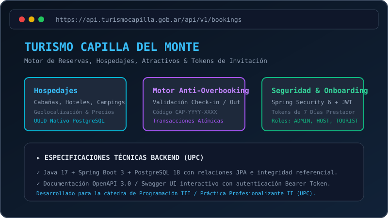

# 🚀 Juan Cruz Larcher • Backend Developer Portfolio

<p align="center">
  
</p>

<p align="center">
  
  
  
  
  
</p>

---

## 🎮 Acerca del Proyecto

Portafolio web personal e interactivo desarrollado con estética **cyberpunk / gamer RPG espacial**, diseñado para presentar mi trayectoria y proyectos como **Desarrollador Backend** especializado en **Java, Spring Boot, Spring Data JPA, PostgreSQL y MySQL**.

### ✨ Características Principales
* **Gamificación en Vivo:** Sistema de experiencia (XP) persistido en `localStorage` con alertas y toasts animados al subir de nivel (*Level Up!*).
* **Catálogo de Misiones (Proyectos):** Tarjetas interactivas con acceso directo a repositorios de GitHub y modal con carrusel de capturas, diagramas de arquitectura en capas, esquemas DER y Swagger UI / OpenAPI.
* **Bilingüe (i18n):** Cambio instantáneo entre Español e Inglés con sincronización automática del atributo `lang` en HTML.
* **Fondo Espacial Dinámico:** Campo de estrellas con efecto paralaje determinista y nebulosa reactiva al scroll.
* **Accesibilidad & UX:** Totalmente operable mediante teclado (`role="dialog"`, `role="button"`, `tabIndex`, ARIA labels) y notificación toast personalizada para copiado de correo sin alertas invasivas del navegador.
* **Optimización WebP:** Imagen de perfil convertida a formato WebP moderno de alta fidelidad con carga rápida (LCP).

---

## 🛠️ Stack Tecnológico

| Capa / Área | Tecnologías |
|---|---|
| **Frontend Core** | React 19, JavaScript (ESModules) |
| **Tooling & Build** | Vite 8, PostCSS, ESLint 10 |
| **Estilos & UI** | Tailwind CSS v4, React Icons |
| **Testing** | Vitest, React Testing Library, JSDOM |
| **Deploy & Hosting** | Vercel / Netlify (con fallback SPA configurado) |
| **Especialidad Backend** | Java 17, Spring Boot 3, Spring Security 6, JJWT, PostgreSQL, MySQL |

---

## 📂 Estructura del Código

```text
mi-portafolio/
├── public/
│   ├── projects/                  # Diagramas SVG y capturas para carrusel
│   ├── CV_Juan_Cruz_Larcher.pdf   # Currículum descargable
│   ├── JuanCruzLarcherIMG.webp    # Imagen de perfil optimizada
│   └── favicon.svg                # Favicon del sitio
├── src/
│   ├── components/                # Componentes modulares
│   │   ├── AboutSection.jsx
│   │   ├── ContactSection.jsx     # Copiado de email con manejo seguro
│   │   ├── Footer.jsx             # Pie bilingüe y copyright dinámico
│   │   ├── HeroSection.jsx        # Portada, redes y botón de CV
│   │   ├── InventorySection.jsx   # Logros y competencias técnicas
│   │   ├── Navbar.jsx             # Navegación con 5 secciones y contador XP
│   │   ├── ProjectModal.jsx       # Modal accesible con carrusel de fotos/docs
│   │   ├── ProjectsSection.jsx    # Tarjetas interactivas de misiones
│   │   ├── SpaceBackground.jsx    # Fondo espacial y paralaje
│   │   ├── TimelineSection.jsx    # Quest Log con soft skills
│   │   └── ToastNotification.jsx  # Toast flotante cyberpunk
│   ├── i18n/
│   │   ├── es.js                  # Contenidos en español
│   │   └── en.js                  # Contenidos en inglés
│   ├── App.jsx                    # Controlador principal y persistencia
│   └── main.jsx
├── tests/                         # Pruebas automatizadas con Vitest
├── vercel.json                    # Reglas de enrutamiento para Vercel
├── netlify.toml                   # Reglas de enrutamiento para Netlify
└── package.json
```

---

## 💻 Scripts Disponibles

En el directorio del proyecto puedes ejecutar:

```bash
# Iniciar servidor de desarrollo local
npm run dev

# Compilar para producción (carpeta /dist)
npm run build

# Ejecutar el linter para asegurar calidad de código
npm run lint

# Ejecutar las pruebas unitarias
npm run test
```

---

## 🚀 Despliegue (Deploy)

El proyecto incluye configuraciones listas para despliegue continuo en:

* **Vercel:** Simplemente conecta el repositorio GitHub en el panel de Vercel. Detectará Vite automáticamente y utilizará `vercel.json` para el enrutamiento SPA.
* **Netlify:** Conecta el repositorio en Netlify; el archivo `netlify.toml` asegura la redirección de rutas a `index.html`.

---

## 📬 Contacto

* **Email:** [juancruzlarcher07@gmail.com](mailto:juancruzlarcher07@gmail.com)
* **LinkedIn:** [linkedin.com/in/juancruzlarcher](https://linkedin.com/in/juancruzlarcher)
* **GitHub:** [github.com/juanetee07](https://github.com/juanetee07)
